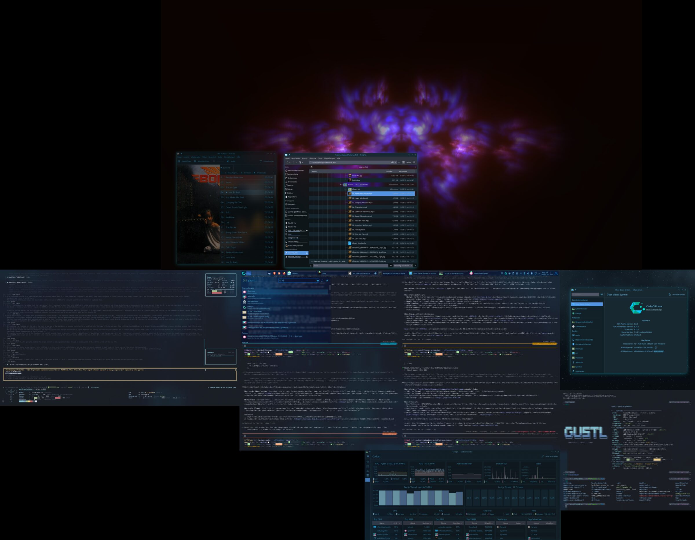
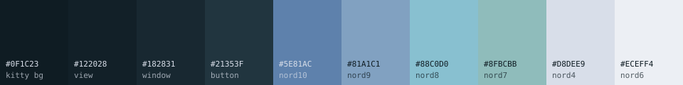
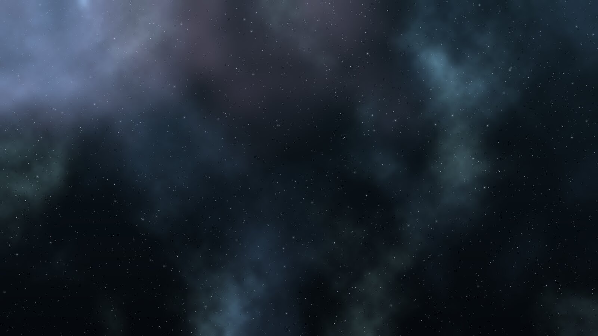

<p align="center">
  
</p>

<h1 align="center">Nord Glass</h1>

<p align="center">
  <strong>Nord for KDE Plasma 6 — made of glass instead of grey.</strong><br />
  Translucent windows, light blur, a quiet Frost shimmer around the edges.<br />
  One command, adapts to your system, fully reversible.
</p>

<p align="center">
  <a href="README.md">Deutsch</a> ·
  <a href="#install">Install</a> ·
  <a href="#tweak">Tweak</a> ·
  <a href="#nebula-wallpaper-across-all-monitors">Nebula wallpaper</a>
</p>

---

Nord is one of the most loved palettes — yet on the desktop it often looks flat and grey. **Nord Glass** turns the Nord colors into glass: windows let what's behind them shine through without making text unreadable. Instead of the usual Nord grey, every background is **slightly cyan-tinted**. Grey turns milky when translucent; cyan stays clear.

<p align="center"></p>

## What's inside

| Part | What it does | Needs |
|---|---|---|
| **Kvantum theme** `NordGlass` | Qt/KDE apps with translucent windows and menus, blur behind | `kvantum` |
| **Color scheme** `NordGlass` | Plasma colors: cyan-tinted Polar Night, Frost accent, no purple | — |
| **Blur** | [Better Blur DX](https://github.com/xarblu/kwin-effects-better-blur-dx) with subtle edge refraction; falls back to the stock KWin blur | optional |
| **Window rules** | browsers, Dolphin, Kate, Haruna, VS Code & co. get their own transparency | — |
| **Glow** | a quiet Frost shimmer around the active window instead of loud neon | Breeze decoration |
| **kitty** | matching terminal theme with its own transparency | `kitty` |
| **Nebula wallpaper** | a generated Nord nebula spanning all monitors, each at native resolution | `python3`, `numpy`, `pillow` |

## Install

```bash
git clone https://github.com/ChristianGruend/nord-glass-kde.git
cd nord-glass-kde
./install.sh --dry-run    # see what would happen first
./install.sh
```

Restart open apps once so Kvantum picks up the theme.

**The installer adapts:**

- **No Kvantum?** The widget theme is skipped, everything else still works.
- **No Better Blur DX?** The stock KWin blur takes over. It only blurs apps that ask for it (Kvantum apps, kitty). For blur everywhere plus refraction, get the plugin (Arch: `kwin-effects-better-blur-dx-git` from the AUR).
- **Not using Breeze decorations?** The glow is left out.
- **No kitty?** Skipped. With kitty, the theme is added via `include` at the end of your `kitty.conf` — your own config stays untouched.
- **Your settings survive:** existing window rules and blur lists are extended, not replaced.

Only some parts: `./install.sh --only blur,rules` · everything except: `./install.sh --skip kitty,glow`
Parts: `kvantum` · `colors` · `blur` · `rules` · `glow` · `kitty`

**Undo:** `./install.sh --uninstall` restores the backup taken on the first run in `~/.local/share/nord-glass/backup`.

## Tweak

Everything that matters lives in [`nord-glass.conf`](nord-glass.conf). Edit it, run `./install.sh` again — done.

| Setting | Default | Effect |
|---|---|---|
| `BLUR_STRENGTH` | `3` | 1–15. Low = you can still tell what's behind. 15 = frosted glass. |
| `REFRACTION` | `4` | light bending at window edges (Better Blur DX only), 0 = off |
| `KVANTUM_WINDOW_OPACITY` | `50` | how much Kvantum makes window backgrounds see-through |
| `GLOW_STRENGTH` | `70` | 0–255, 70 = quiet shimmer, 200+ = neon |
| `APPS` | browsers, Dolphin, … | `"window-class:active%:inactive%"` per app |
| `KITTY_OPACITY` | `0.42` | terminal transparency |

Find an app's window class with **Alt+F3 → More Actions → Configure Special Window Settings → Detect Window Properties**.

## Nebula wallpaper across all monitors

<p align="center"></p>

Plasma can't span one image across several monitors. `tools/nebula-wallpaper.py` does: it reads your monitor layout, renders a nebula at **exactly that size** (never upscaled, never blurry), cuts each monitor's area at native resolution and applies it. Shapes flow cleanly across screen edges.

```bash
tools/nebula-wallpaper.py                    # generate and apply on all monitors
tools/nebula-wallpaper.py --seed 42          # a different nebula
tools/nebula-wallpaper.py ~/photo.jpg        # span your own image across all monitors
tools/nebula-wallpaper.py --size 3840x2160   # just write one image (any desktop, no KDE)
tools/nebula-wallpaper.py --skybox           # plus a panorama background for the desktop cube
```

## Tested on

CachyOS · KDE Plasma 6.8 · Wayland · five monitors with mixed resolutions (4K, 1440p, 1080p, portrait). Other Plasma 6 distributions should work — feedback welcome as an issue.

## Credits & license

Nord Glass stands on good work:

- [Nord](https://www.nordtheme.com) by Arctic Ice Studio — the palette
- Kvantum theme derived from **KvArcDark** by Tsu Jan from [Kvantum](https://github.com/tsujan/Kvantum) (GPL-3.0-or-later)
- Color scheme derived from **CachyOSNordLightly** from [CachyOS-Nord-KDE](https://github.com/CachyOS/CachyOS-Nord-KDE) (GPL-3.0-or-later)
- Blur: [Better Blur DX](https://github.com/xarblu/kwin-effects-better-blur-dx) (configured, not bundled)

Nord Glass is therefore licensed **GPL-3.0-or-later** as well — see [LICENSE](LICENSE).
