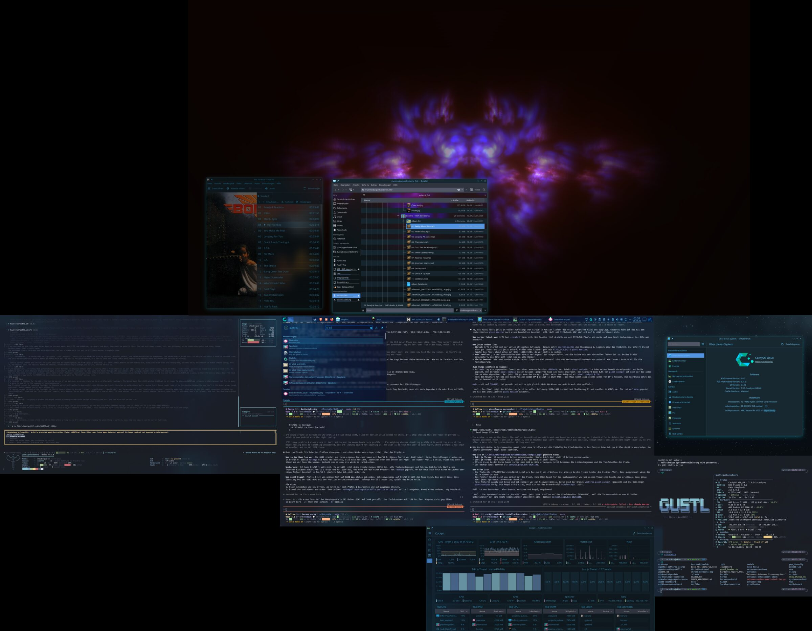
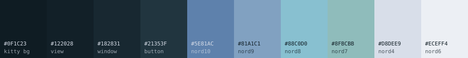
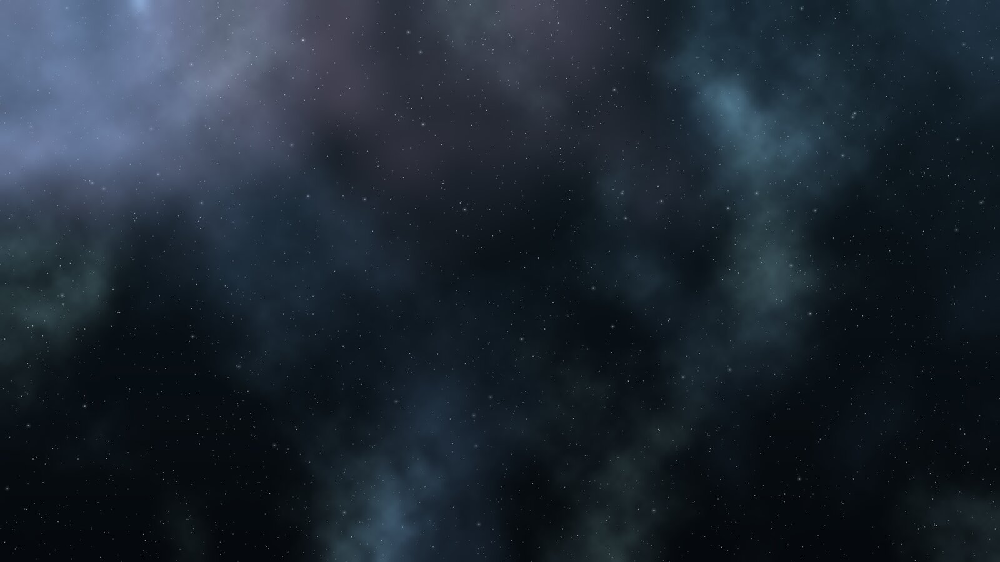

<p align="center">
  
</p>

<h1 align="center">Nord Glass</h1>

<p align="center">
  <strong>Nord für KDE Plasma 6 — aus Glas statt aus Grau.</strong><br />
  Halbtransparente Fenster, leichter Blur, ein leiser Frost-Schimmer an den Kanten.<br />
  Ein Befehl, passt sich deinem System an, komplett rückgängig zu machen.
</p>

<p align="center">
  <a href="README.en.md">English</a> ·
  <a href="#installation">Installation</a> ·
  <a href="#einstellen">Einstellen</a> ·
  <a href="#nebel-hintergrund-über-alle-monitore">Nebel-Hintergrund</a>
</p>

---

Nord ist eine der beliebtesten Paletten — auf dem Desktop wirkt sie aber oft flach und grau. **Nord Glass** nimmt die Nord-Farben und macht daraus Glas: Fenster lassen durchscheinen, was dahinter liegt, ohne dass Text unlesbar wird. Statt des typischen Nord-Graus sind alle Hintergründe **leicht cyan getönt**. Bei Transparenz wird Grau milchig, Cyan bleibt klar.

<p align="center"></p>

## Was drin ist

| Teil | Was es macht | Braucht |
|---|---|---|
| **Kvantum-Theme** `NordGlass` | Qt-/KDE-Apps mit halbtransparenten Fenstern und Menüs, Blur dahinter | `kvantum` |
| **Farbschema** `NordGlass` | Plasma-Farben: cyan-getöntes Polar Night, Frost als Akzent, kein Lila | — |
| **Blur** | [Better Blur DX](https://github.com/xarblu/kwin-effects-better-blur-dx) mit dezenter Lichtbrechung am Rand; ohne das Plugin der normale KWin-Blur | optional |
| **Fensterregeln** | Browser, Dolphin, Kate, Haruna, VS Code & Co. bekommen eine eigene Transparenz | — |
| **Glow** | leiser Frost-Schimmer um das aktive Fenster statt grellem Neon | Breeze-Deko |
| **kitty** | passendes Terminal-Theme mit eigener Transparenz | `kitty` |
| **Nebel-Hintergrund** | generierter Nord-Nebel über alle Monitore, jeder in nativer Auflösung | `python3`, `numpy`, `pillow` |

## Installation

```bash
git clone https://github.com/ChristianGruend/nord-glass-kde.git
cd nord-glass-kde
./install.sh --dry-run    # erst ansehen, was passieren würde
./install.sh
```

Danach offene Apps einmal neu starten, damit Kvantum greift.

**Der Installer passt sich an:**

- **Kein Kvantum?** Das Widget-Theme wird übersprungen, alles andere läuft trotzdem.
- **Kein Better Blur DX?** Dann übernimmt der normale KWin-Blur. Der blurrt nur Apps, die es selbst anfordern (Kvantum-Apps, kitty). Für Blur überall plus Lichtbrechung lohnt das Plugin (Arch: `kwin-effects-better-blur-dx-git` aus dem AUR).
- **Andere Fensterdeko als Breeze?** Der Glow wird ausgelassen.
- **Kein kitty?** Wird übersprungen. Ist kitty da, bindet sich das Theme per `include` am Ende deiner `kitty.conf` ein — deine eigene Config bleibt unangetastet.
- **Vorhandene Einstellungen bleiben:** Eigene Fensterregeln und Blur-Listen werden ergänzt, nicht ersetzt.

Nur einzelne Teile: `./install.sh --only blur,rules` · alles außer: `./install.sh --skip kitty,glow`
Teile: `kvantum` · `colors` · `blur` · `rules` · `glow` · `kitty`

**Rückgängig:** `./install.sh --uninstall` stellt die Sicherung wieder her, die beim ersten Lauf unter `~/.local/share/nord-glass/backup` angelegt wurde.

## Einstellen

Alles Wichtige steht in [`nord-glass.conf`](nord-glass.conf). Ändern, `./install.sh` erneut ausführen — fertig.

| Einstellung | Standard | Wirkung |
|---|---|---|
| `BLUR_STRENGTH` | `3` | 1–15. Klein = man erkennt, was dahinter liegt. 15 = Milchglas. |
| `REFRACTION` | `4` | Lichtbrechung am Fensterrand (nur Better Blur DX), 0 = aus |
| `KVANTUM_WINDOW_OPACITY` | `50` | wie stark Kvantum Fensterhintergründe durchsichtig macht |
| `GLOW_STRENGTH` | `70` | 0–255, 70 = leiser Schimmer, 200+ = Neon |
| `APPS` | Browser, Dolphin, … | `"fensterklasse:aktiv%:inaktiv%"` je App |
| `KITTY_OPACITY` | `0.42` | Transparenz des Terminals |

Die Fensterklasse einer App findest du mit **Alt+F3 → Weitere Aktionen → Spezielle Fenstereinstellungen → Fenstereigenschaften ermitteln**.

## Nebel-Hintergrund über alle Monitore

<p align="center"></p>

Plasma kann ein Bild nicht über mehrere Monitore spannen. `tools/nebula-wallpaper.py` erledigt das: Es liest dein Monitor-Layout, erzeugt einen Nebel in **genau dieser Größe** (nie hochskaliert, nie unscharf), schneidet für jeden Monitor seinen Ausschnitt in nativer Auflösung und setzt ihn. Motive laufen sauber über die Bildschirmkanten.

```bash
tools/nebula-wallpaper.py                 # Nebel erzeugen und auf allen Monitoren setzen
tools/nebula-wallpaper.py --seed 42       # anderer Nebel
tools/nebula-wallpaper.py ~/foto.jpg      # eigenes Bild über alle Monitore spannen
tools/nebula-wallpaper.py --size 3840x2160   # nur ein Bild schreiben (jeder Desktop, ohne KDE)
tools/nebula-wallpaper.py --skybox        # dazu ein Panorama als Hintergrund für den Desktop-Würfel
```

## Getestet

CachyOS · KDE Plasma 6.8 · Wayland · fünf Monitore mit gemischten Auflösungen (4K, 1440p, 1080p, hochkant). Andere Plasma-6-Distributionen sollten funktionieren — Rückmeldungen gern als Issue.

## Herkunft & Lizenz

Nord Glass baut auf guter Vorarbeit auf:

- [Nord](https://www.nordtheme.com) von Arctic Ice Studio — die Palette
- Kvantum-Theme abgeleitet von **KvArcDark** von Tsu Jan aus [Kvantum](https://github.com/tsujan/Kvantum) (GPL-3.0-or-later)
- Farbschema abgeleitet von **CachyOSNordLightly** aus [CachyOS-Nord-KDE](https://github.com/CachyOS/CachyOS-Nord-KDE) (GPL-3.0-or-later)
- Blur: [Better Blur DX](https://github.com/xarblu/kwin-effects-better-blur-dx) (wird nur konfiguriert, nicht mitgeliefert)

Nord Glass steht deshalb ebenfalls unter **GPL-3.0-or-later** — siehe [LICENSE](LICENSE).
